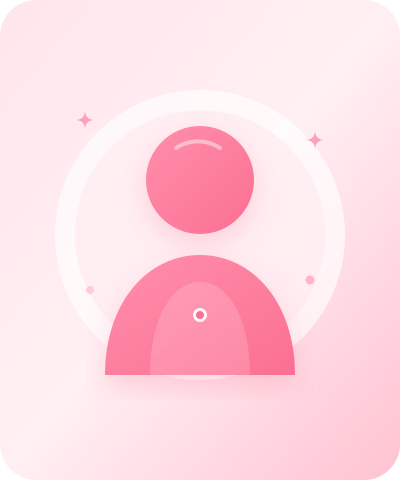

# Portfólio Pessoal • Maria Eduarda 🌸

Portfólio web autoral, moderno e delicado, desenvolvido especialmente para **Maria Eduarda**, estudante do curso técnico de Informática no **Instituto Educacional Raphael Di Santo** em Campinas (SP).

---

## 🎨 Identidade Visual & Design

O design foi concebido com uma estética feminina, suave e altamente profissional, inspirada nas referências modernas de estúdios e designers digitais contemporâneos (*Landonorris.com*, *Unseen.co* e *Igloo.inc*), unindo micro-interações, tipografia elegante e animações fluidas.

### Paleta de Cores Utilizada:
- `#FFE5EC` — Rosa suave (fundos e detalhes sutis)
- `#FFC2D1` — Rosa pastel delicado
- `#FFB3C6` — Rosa intermediário (bordas e badges)
- `#FF8FAB` — Rosa vibrante (gradientes e destaques)
- `#FB6F92` — Rosa principal de destaque (botões, ícones e ações)
- `#2D1D25` — Tom escuro refinado para excelente legibilidade e contraste
- `#FFF8F9` — Fundo principal acolhedor

---

## 📁 Estrutura do Projeto

```text
├── index.html                 # Estrutura semântica e acessível
├── style.css                  # Estilos modernos, responsivos e variáveis CSS
├── script.js                  # Animações, canvas de pétalas e interatividade
├── README.md                  # Manual de uso e personalização
└── img/                       # Vetores e imagens do portfólio
    ├── favicon.svg            # Ícone floral da aba do navegador
    ├── boneco-rosa.svg        # Silhueta de boneco rosa minimalista e delicada
    ├── project-portfolio.svg  # Mockup visual do portfólio
    ├── project-placeholder-1.svg # Mockup para projetos acadêmicos
    ├── project-placeholder-2.svg # Mockup para aplicações web futuras
    └── floral-motif.svg       # Elementos decorativos florais
```

---

## 🚀 Como Executar o Projeto

1. Basta abrir o arquivo `index.html` em qualquer navegador (Google Chrome, Microsoft Edge, Firefox, Safari).
2. Se estiver utilizando o **VS Code**, você também pode clicar com o botão direito em `index.html` e selecionar **"Open with Live Server"**.

---

## 💡 Como Personalizar seu Portfólio

### 1. Adicionar sua Fotografia Pessoal
Na seção **Sobre Mim**, há um espaço reservado com uma moldura delicada.
- Adicione a sua foto (por exemplo, `minha-foto.jpg`) dentro da pasta `img/`.
- No arquivo `index.html`, procure pela tag:
  ```html
  
  ```
- Altere `img/boneco-rosa.svg` para `img/minha-foto.jpg`.

### 2. Adicionar seu Usuário do GitHub
No arquivo `index.html`, localize o link do GitHub na seção de Contato e no rodapé:
```html
<a href="https://github.com/SEU-USUARIO" target="_blank" ...>
```
Basta substituir pelo seu link real do perfil no GitHub.

### 3. Adicionar Novos Projetos na Galeria
Para inserir novos projetos, localize a div `<div class="projects-grid" id="projects-container">` no `index.html` e duplique o bloco:

```html
<article class="project-card reveal">
  <div class="project-image-box">
    
    <div class="project-overlay-badge">
      <span class="badge-dot"></span>
      <span>Projeto Concluído 🌸</span>
    </div>
  </div>
  <div class="project-details">
    <div class="project-tags">
      <span class="tech-tag">HTML5</span>
      <span class="tech-tag">CSS3</span>
    </div>
    <h3 class="project-title">Nome do Seu Projeto</h3>
    <p class="project-description">Descrição clara do projeto...</p>
    <div class="project-footer-actions">
      <a href="LINK_DO_PROJETO" class="btn btn-card-primary" target="_blank">Visualizar Demo</a>
    </div>
  </div>
</article>
```

---

## 🌸 Funcionalidades Implementadas

- **Canvas Interativo de Pétalas**: Chuva de pétalas de cerejeira (sakura) flutuando suavemente em segundo plano, com física fluida e pausa automática quando a aba está em segundo plano.
- **Cursor Delicado com Seguidor Suave**: Ponto e anel com interpolação linear (LERP) que expande sobre botões e links em telas de computador.
- **Animações de Rolagem (Scroll Reveal)**: Elementos surgem suavemente na tela com efeito de cascata (stagger) através da API nativa `IntersectionObserver`.
- **Navbar Fixa Glassmorphism**: Efeito de vidro fosco (`backdrop-filter: blur`), redução inteligente de altura ao rolar e indicador automático da seção atual.
- **Menu Mobile Adaptado**: Gaveta lateral animada e acessível via toque e teclado.
- **Relógio Dinâmico de Campinas**: Exibe o horário local de Campinas, SP em tempo real no mockup da tela inicial.
- **Efeito Magnético em Botões**: Micro-interação onde os botões reagem suavemente à posição do mouse.
- **Botão Voltar ao Topo**: Surge após rolagem e conduz o usuário ao início da página com rolagem suave.
- **Formulário com Toast Notification**: Validação e aviso carinhoso personalizado sem recarregar a página.

---

## 🌐 Publicação na Web (Gratuita)

Você pode publicar seu portfólio gratuitamente em minutos através de:
- **GitHub Pages**: Crie um repositório chamado `portfolio` no GitHub, envie os arquivos e ative o Pages nas configurações (*Settings > Pages*).
- **Vercel** ou **Netlify**: Conecte o repositório ou arraste a pasta diretamente para ter seu site no ar com HTTPS imediato.

